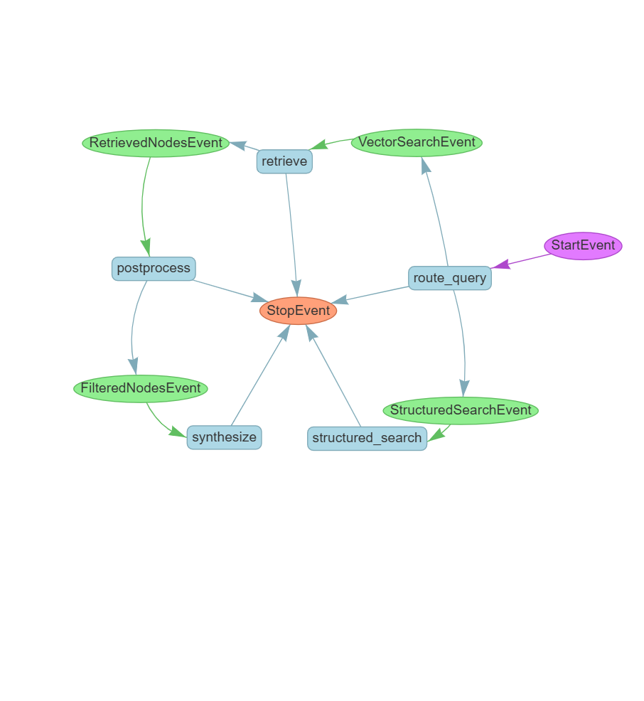

# 🚀 AI Developer Assistant: RAG with LlamaIndex

> A Retrieval-Augmented Generation assistant that answers developers' questions about a software project (architecture, UI rules, technical decisions, warnings), using a **smart router** that picks the right retrieval strategy for every question.



## 🎯 The problem
Plain vector search is great for open questions, but it **misses items** when you ask for a complete list
("what are *all* the UI rules?"). Returning 3 similar chunks out of 12 rules is a wrong answer.

## 🧠 The solution: a routed workflow
Built with **LlamaIndex Workflows**, every question goes through a router:

| Question type | Route | Why |
|---|---|---|
| Open knowledge: *"How does login work?"* | 🔎 **Vector search** in Pinecone | Semantic similarity finds the relevant context |
| List / exact: *"List all developer warnings"* | 📋 **Structured lookup** in a JSON knowledge base | Returns 100% of the items, with nothing missed |

The answer is then generated by **Cohere `command-r-08-2024`**, with **`embed-multilingual-v3.0`** embeddings so it works in Hebrew and English.

## 📁 Project structure
```
rag_app/
├── extract_data.py   # Extracts structured items (rules, decisions, warnings) into JSON
├── ingest_data.py    # Chunks, embeds and uploads the documents to Pinecone
└── query_engine.py   # LlamaIndex Workflow: router → vector / structured → answer
ui/chat_app.py        # Gradio chat interface
data/                 # Sample project documentation (architecture, rules, decisions, logs)
```

## 🚀 Getting started
```bash
pip install llama-index pinecone cohere gradio python-dotenv
```
Create a `.env` file:
```env
COHERE_API_KEY=your_key_here
PINECONE_API_KEY=your_key_here
PINECONE_INDEX_NAME=your_index_here
```
Then:
```bash
python rag_app/ingest_data.py   # one-time: build the index
python ui/chat_app.py           # open http://127.0.0.1:7860
```

## 💬 Example questions
- *"What happens when a team manager is deleted?"* → vector search
- *"How does the login mechanism work?"* → vector search
- *"List all the UI rules"* → structured lookup
- *"What technical decisions were made?"* → structured lookup

---
👩‍💻 Built by **Leah Levovitz** · [GitHub](https://github.com/leahlevovitz)
